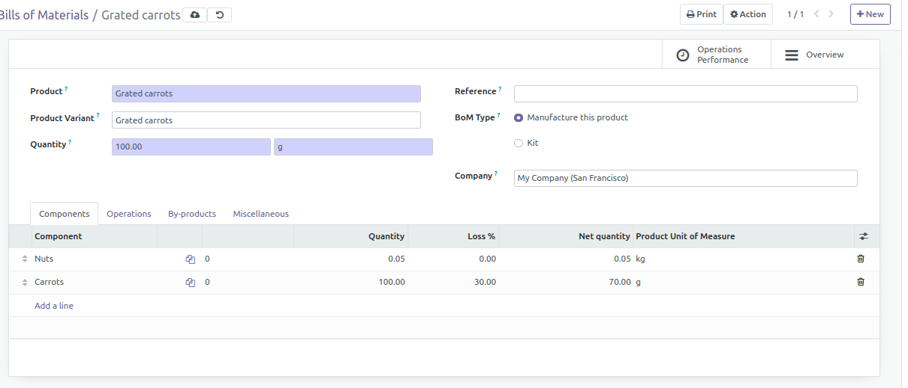
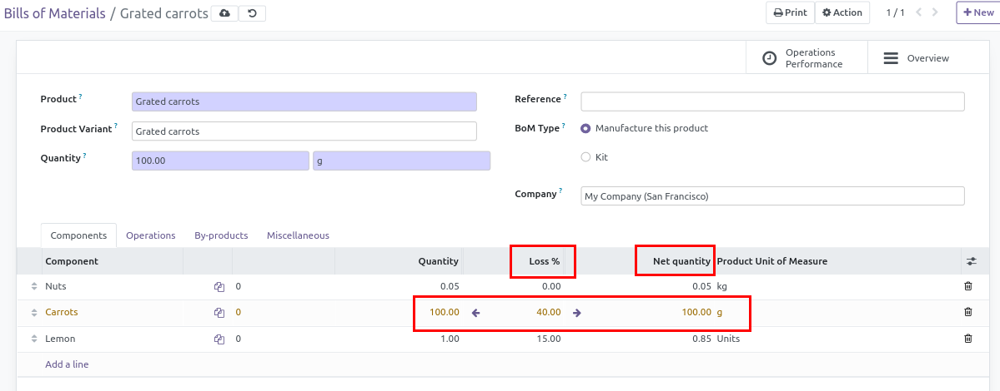
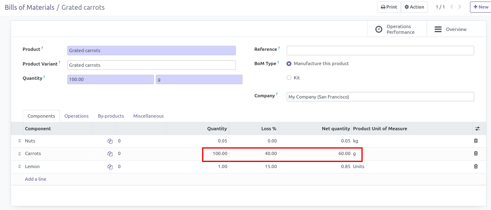

.. image:: https://odoo-community.org/readme-banner-image
   :target: https://odoo-community.org/get-involved?utm_source=readme
   :alt: Odoo Community Association

===================================
MRP BoM Line Net and Gross Quantity
===================================

.. 
   !!!!!!!!!!!!!!!!!!!!!!!!!!!!!!!!!!!!!!!!!!!!!!!!!!!!
   !! This file is generated by oca-gen-addon-readme !!
   !! changes will be overwritten.                   !!
   !!!!!!!!!!!!!!!!!!!!!!!!!!!!!!!!!!!!!!!!!!!!!!!!!!!!
   !! source digest: sha256:8623dbc6f373a5932ff63721e4784d2cac036e00cf7b7e9008dbb2e7e6d36c37
   !!!!!!!!!!!!!!!!!!!!!!!!!!!!!!!!!!!!!!!!!!!!!!!!!!!!

.. |badge1| image:: https://img.shields.io/badge/maturity-Beta-yellow.png
    :target: https://odoo-community.org/page/development-status
    :alt: Beta
.. |badge2| image:: https://img.shields.io/badge/license-AGPL--3-blue.png
    :target: http://www.gnu.org/licenses/agpl-3.0-standalone.html
    :alt: License: AGPL-3
.. |badge3| image:: https://img.shields.io/badge/github-OCA%2Fmanufacture-lightgray.png?logo=github
    :target: https://github.com/OCA/manufacture/tree/18.0/mrp_bom_line_net_qty
    :alt: OCA/manufacture
.. |badge4| image:: https://img.shields.io/badge/weblate-Translate%20me-F47D42.png
    :target: https://translation.odoo-community.org/projects/manufacture-18-0/manufacture-18-0-mrp_bom_line_net_qty
    :alt: Translate me on Weblate
.. |badge5| image:: https://img.shields.io/badge/runboat-Try%20me-875A7B.png
    :target: https://runboat.odoo-community.org/builds?repo=OCA/manufacture&target_branch=18.0
    :alt: Try me on Runboat

|badge1| |badge2| |badge3| |badge4| |badge5|

Handle gross and net quantity on BoM lines thanks to loss percentage
Fill quantity (original one is 'gross quantity') : it set automatically
'net quantity' Fill loss percentage, Odoo will show two buttons to
calculate net or 'gross quantity' You can also set 'net quantity' and
calculate 'gross quantity' with loss percentage

|image1|

Here are the added fields

|image2|

|image3|

/!Line with difference with theorical values are set in yellow

**Table of contents**

.. contents::
   :local:

Bug Tracker
===========

Bugs are tracked on `GitHub Issues <https://github.com/OCA/manufacture/issues>`_.
In case of trouble, please check there if your issue has already been reported.
If you spotted it first, help us to smash it by providing a detailed and welcomed
`feedback <https://github.com/OCA/manufacture/issues/new?body=module:%20mrp_bom_line_net_qty%0Aversion:%2018.0%0A%0A**Steps%20to%20reproduce**%0A-%20...%0A%0A**Current%20behavior**%0A%0A**Expected%20behavior**>`_.

Do not contact contributors directly about support or help with technical issues.

Credits
=======

Authors
-------

* GRAP

Contributors
------------

- Quentin Dupont (quentin.dupont@grap.coop)

Maintainers
-----------

This module is maintained by the OCA.

.. image:: https://odoo-community.org/logo.png
   :alt: Odoo Community Association
   :target: https://odoo-community.org

OCA, or the Odoo Community Association, is a nonprofit organization whose
mission is to support the collaborative development of Odoo features and
promote its widespread use.

.. |maintainer-quentinDupont| image:: https://github.com/quentinDupont.png?size=40px
    :target: https://github.com/quentinDupont
    :alt: quentinDupont

Current `maintainer <https://odoo-community.org/page/maintainer-role>`__:

|maintainer-quentinDupont| 

This module is part of the `OCA/manufacture <https://github.com/OCA/manufacture/tree/18.0/mrp_bom_line_net_qty>`_ project on GitHub.

You are welcome to contribute. To learn how please visit https://odoo-community.org/page/Contribute.
